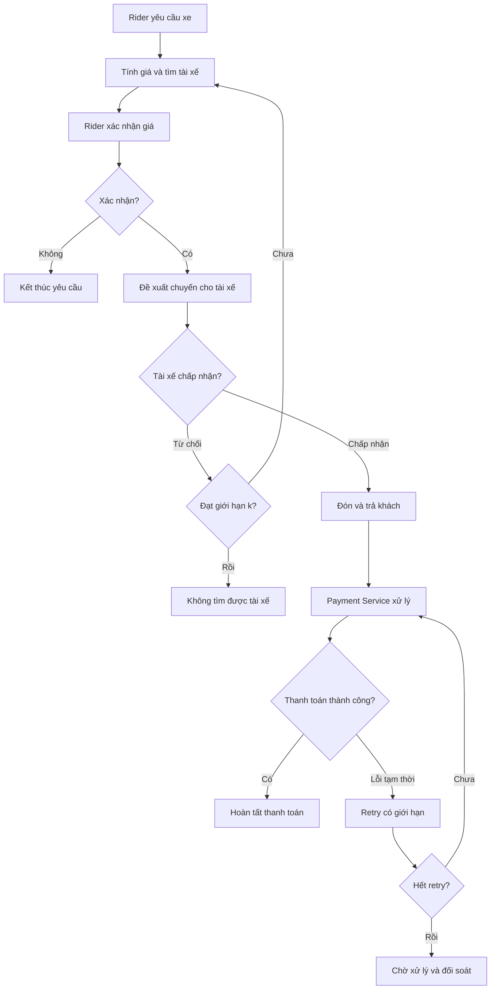

# SwiftRide — Hệ thống đặt xe trực tuyến

## 1. Giới thiệu

SwiftRide là hệ thống đặt xe trực tuyến được xây dựng theo kiến trúc Microservices bằng ASP.NET Core. Các service giao tiếp qua HTTP và RabbitMQ nhằm phân tách nghiệp vụ, giảm phụ thuộc và hỗ trợ xử lý bất đồng bộ.

## 2. Công nghệ sử dụng

- ASP.NET Core Web API
- YARP API Gateway
- JWT Authentication
- RabbitMQ
- Docker & Docker Compose
- Postman

## 3. Kiến trúc hệ thống

| Thành phần | Chức năng |
|---|---|
| API Gateway | Định tuyến request và xác thực JWT theo cấu hình. |
| Auth Service | Xác thực người dùng và cấp token. |
| Trip Service | Quản lý chuyến đi và trạng thái chuyến. |
| Matching Service | Tính giá, tìm kiếm và phân công tài xế. |
| Payment Service | Xử lý thanh toán và theo dõi trạng thái giao dịch. |
| RabbitMQ | Truyền message và event bất đồng bộ giữa các service. |

Các service quản lý nghiệp vụ và dữ liệu của mình độc lập.

## 4. Giao tiếp giữa các service

- **HTTP:** Dùng cho giao tiếp đồng bộ, khi bên gọi cần nhận phản hồi trực tiếp.
- **RabbitMQ:** Dùng cho giao tiếp bất đồng bộ thông qua event hoặc command.

Một số event dự kiến:

| Event | Service gửi | Service nhận |
|---|---|---|
| `TripCreated` | Trip Service | Matching Service |
| `DriverAssigned` | Matching Service | Trip Service |
| `PaymentRequested` | Service nghiệp vụ phù hợp | Payment Service |
| `PaymentCompleted` | Payment Service | Service liên quan |

Cấu trúc message được định nghĩa bằng DTO hoặc message contract dùng chung giữa bên gửi và bên nhận.

## 5. Luồng nghiệp vụ đặt xe

1. Rider yêu cầu chuyến đi thông qua API Gateway.
2. Matching Service tính giá và tìm tài xế phù hợp.
3. Rider xác nhận giá trước khi hệ thống đề xuất chuyến đi cho tài xế.
4. Nếu tài xế từ chối, hệ thống tìm tài xế khác cho đến khi đạt giới hạn từ chối `k`. Nếu vượt ngưỡng thất bại theo quy tắc nghiệp vụ, yêu cầu kết thúc.
5. Nếu tài xế chấp nhận, chuyến đi được thực hiện từ điểm đón đến điểm trả khách.
6. Khi chuyến đi hoàn tất, Payment Service xử lý thanh toán.
7. Nếu thanh toán gặp lỗi tạm thời, hệ thống retry có giới hạn với cùng một idempotency key. Nếu vẫn chưa xác định được kết quả, giao dịch chuyển sang trạng thái chờ xử lý để đối soát.

### Sơ đồ luồng đặt xe



### Nguyên tắc thanh toán

- Giữ nguyên idempotency key trong mọi lần retry của cùng giao dịch.
- Không mặc định timeout đồng nghĩa với thanh toán thất bại.
- Chỉ đánh dấu thành công khi có kết quả xác nhận đáng tin cậy.
- Hỗ trợ xử lý message trùng để tránh giao dịch bị thực hiện nhiều lần.

## 6. Cấu trúc dự án

```text
SwiftRide/
├── src/
│   ├── ApiGetway/
│   ├── AuthService/
│   ├── TripService/
│   ├── MatchingService/
│   └── PaymentService/
├── .env.example
├── .gitignore
├── docker-compose.yml
├── README.md
└── SwiftRide.slnx
```

## 7. Cấu hình và khởi chạy

### Yêu cầu

- Docker và Docker Compose
- .NET SDK phù hợp với dự án
- Postman để kiểm thử API

### Cấu hình

Tạo file `.env` từ `.env.example`, sau đó cấu hình JWT, connection string database và thông tin kết nối RabbitMQ. Không đưa thông tin bí mật vào Git.

### Chạy hệ thống

```bash
docker compose up --build -d
```

Kiểm tra trạng thái container:

```bash
docker compose ps
```

Xem log API Gateway:

```bash
docker compose logs -f api_gateway
```

Tên service trong các lệnh phải khớp với cấu hình thực tế trong `docker-compose.yml`.
